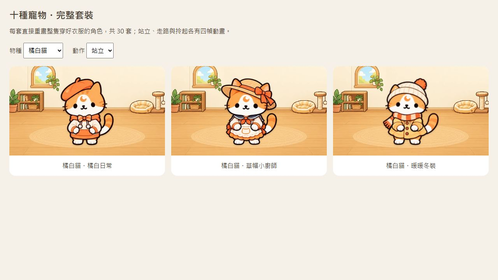
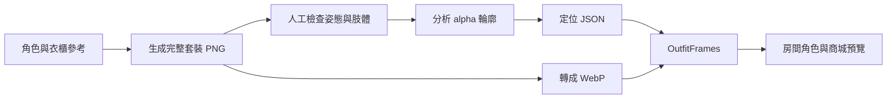
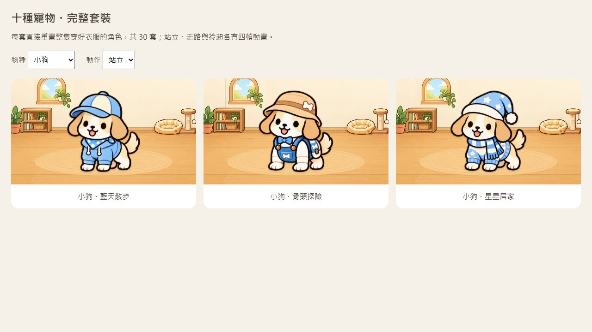

# 寵物完整套裝：製作、動畫與商城整合教學

製作紀錄日期：2026-10-14。這份文件記錄實際做過的流程與失敗，不把生成結果當成保證正確的成品。閱讀順序建議：先看圖片與設計決策，再看資料流，最後操作重建指令。

目前成果：十種寵物各三套，共 **30 套完整角色圖、360 幀**。每套包含站立、走路、拎起，各四幀。商城以完整套裝購買與換裝，保留原單品購買紀錄並免費解鎖對應套裝。



## 1. 為什麼原本的做法失敗

最初把帽子、衣服、配件當成獨立透明圖片，疊在原寵物動畫上：

```text
原寵物圖
  + 帽子圖片（left / top / width）
  + 衣服圖片（指定寬高）
  + 配件圖片
```

這很容易做出「可以試穿」的功能，卻不等於「看起來有穿上」。實際遇到：

- 角色有正面、側面與不同身形，衣服大多是正面展示圖。
- 帽沿與頭頂的位置不同，統一尺寸容易蓋臉或浮起來。
- 短身體的角色沒有足夠空間容納原衣服，固定寬高會把衣服壓成腹部貼片。
- 身體、尾巴、下巴與腳掌有前後遮擋關係，單純調整位置處理不了。
- 拎起後，頸部、軀幹、四肢姿勢改變，需要另外一套穿著姿態。

中間曾加入物種錨點、依透明範圍定位、衣服輪廓遮罩，以及下巴和腳掌前景。這些改善了疊圖位置，但沒有把展示用的衣服變成符合角色透視的衣服。相關歷史可看 [2f6f716](https://github.com/Hung-NCKU/fit/commit/2f6f716)。

使用者選擇改成**整套穿搭**後，才改用完整角色圖：帽子、衣服、配件和身體直接一起畫好。這個決策犧牲了任意混搭，換來每套可單獨檢查的完整穿著效果。

## 2. 檔案地圖

所有路徑都相對於 repository 根目錄。

| 檔案／目錄 | 用途 |
|---|---|
| [原衣櫃圖](../pet/穿搭/) | 角色身份、配色與服飾參考 |
| [原寵物動畫](../pet/animation-v2/) | 未穿套裝時的角色素材 |
| [套裝原圖](../pet/outfits-v1/) | 30 張透明 PNG，每張是一套完整角色的動畫圖集 |
| [生成紀錄](../pet/outfits-v1/generation-manifest.json) | 每套的提示詞、參考圖、原始生成位置與保存名稱 |
| [狗的肢體修正紀錄](../pet/outfits-v1/dog-2-anatomy-fix.json) | 後續修正提示詞與人工檢查結果 |
| [WebP 素材](../web/public/pets/outfits-v1/) | 網頁實際下載的圖集 |
| [套裝目錄](../server/src/pet-outfit-catalog.json) | 套裝 ID、物種、名稱、設計內容、舊商品對應 |
| [套裝與相容邏輯](../server/src/pet-outfits.js) | 價格、舊購買解鎖、舊穿戴轉換 |
| [遊戲與交易邏輯](../server/src/pet.js) | 商城、購買、換裝、共用錢包 |
| [API](../server/src/routes/pet.js) | 回傳商城、角色、已擁有商品及穿著 |
| [圖集分析器](../web/tools/analyze-outfits.py) | 從 alpha 輪廓推算每幀顯示範圍 |
| [圖集定位資料](../web/src/pet-outfit-layout.json) | 每幀 viewBox、裁切框、尺寸、來源雜湊 |
| [動畫元件](../web/src/components/OutfitFrames.vue) | 顯示整套角色、播放四幀、處理快取版本 |
| [房間角色](../web/src/components/PetActor.vue) | 遊蕩、朝向、拖曳與套裝姿態切換 |
| [寵物與商城頁](../web/src/views/PetView.vue) | 試穿、購買確認、換裝與商品縮圖 |
| [預覽頁元件](../web/src/WearFitPreview.vue) | 切換物種、系列、站立／走路／拎起 |
| [Vite 設定](../web/vite.config.js) | 同時建置正式 App 與穿搭預覽頁 |

辨認一套素材的例子：

```text
ID：outfit-dog-2
原圖：pet/outfits-v1/outfit-dog-2-source.png
網頁圖：web/public/pets/outfits-v1/outfit-dog-2.webp
定位資料的 key：outfit-dog-2
```

ID 要在目錄、PNG、WebP 與定位資料中一致；不能只改其中一個名稱。

## 3. 先定義套裝，再生成圖片

先在套裝目錄定義每個物種的三套設計。以「骨頭探險」為例，設計包含骨頭漁夫帽、藍色吊帶褲、領結與背包。設計文字用來提示生成模型；商品名稱用來顯示給使用者。

```json
{
  "id": "outfit-dog-2",
  "species": "dog",
  "name": "骨頭探險",
  "legacy": ["wear-dog-2", "wear-dog-6", "wear-dog-8", "wear-dog-9"]
}
```

上面省略了實際目錄裡的英文 design 欄位，完整內容以 JSON 原檔為準。legacy 是購買相容關係，不是執行時要疊上去的圖片清單。

先定義目錄的好處：知道要生成哪 30 張圖、每張對應哪個商品，也能確認每個舊單品都只有一個套裝對應。

## 4. 圖片生成：實際使用方式

本次使用 **Codex 內建 imagegen**，不是 App 裡的 Gemini，也不是由網站在使用者購買時即時生成。沒有另外執行 OpenAI 圖片 API CLI。

操作流程：

1. 先檢視本機參考圖。
2. 把衣櫃圖作為角色身份與服飾風格參考。
3. 說明要生成「已穿好衣服的完整角色」，不是衣服圖層。
4. 要求真正透明背景，生成呼叫設 transparent_background 為 true。
5. 檢視生成結果，逐幀檢查。
6. 從工具回傳的位置複製到 pet/outfits-v1/。
7. 保存完整提示詞與參考資料。

內建工具原始輸出在 Codex 的 generated_images 目錄；manifest 中的 generatedSource 是當時機器的位置，**不是部署路徑**。換電腦後應從 repository 中的 PNG 開始操作，參考圖也改指向自己的 checkout。

重新執行相同提示詞不會保證得到逐像素相同的圖。可重建的是已保存圖片的定位、格式轉換與前端建置；重新生成圖片仍需要人工審圖。

### 提示詞的關鍵結構

以下是教學用摘要；30 套的實際完整提示詞在生成紀錄中。

```text
Use case: identity-preserve.
Generate a COMPLETE ALREADY-DRESSED character, not floating garment overlays.
Preserve species, face, markings, ears, tail, palette and illustration style.
Outfit: [帽子、衣服、配件的具體描述].
Clothing wraps torso and shoulders; paws emerge from sleeves;
neckline sits below chin; tail exits naturally.

Exact grid: FOUR columns by THREE rows, TWELVE complete characters.
Actual transparent alpha. No text, scene, borders or grid lines.
Leave transparent padding between cells; do not crop hats, paws or tails.

ROW 1: aligned idle poses; open / half blink / closed / open.
ROW 2: four right-facing walking phases; nose RIGHT, tail LEFT.
ROW 3: lifted dangling pose; hand holds garment behind neck,
or shoulder garment for birds, upper shell cover for turtles.

Species lock: [這個物種的身體特徵與正確肢體數量].
```

物種限制需要具體：鸚鵡是兩隻腳與兩片翅膀，不能生出哺乳動物的手掌；陸龜要有低身體、龜殼與四隻短腳；天竺鼠不能長出長尾巴。

**「整隻穿好」仍不能保證肢體正確。** 衣服與人體站姿的暗示可能讓模型加出額外前掌，後面的修正案例就是實際發生的錯誤。

## 5. 一張圖集如何變成動畫

每張 PNG 的預期排列：

| 列 | 姿態 | 四幀用途 |
|---|---|---|
| 第一列 | idle | 站立與眨眼 |
| 第二列 | walk | 向右走的四個步態 |
| 第三列 | pickup | 拎起、眨眼與腿部輕微變化 |

30 張 × 3 姿態 × 4 幀 = 360 幀。

生成模型畫出的格距不一定精準。所以程式不直接按圖片寬高等分後裁切，也沒有先把圖拆成 360 個檔案。它保留整張圖集，以 SVG 的 viewBox 與 clipPath 顯示其中一幀。



### 分析器做了什麼

analyze-outfits.py 只讀取圖片，**不修改 PNG 的像素**：

1. 計算 PNG 的 SHA-256。
2. 如果來源雜湊與 layoutVersion 都符合快取，直接重用定位資料。
3. 檢查 alpha 範圍包含 0 與 255；這能確認有完全透明與完全不透明的像素，但不能保證背景的語意完全正確。
4. 以 alpha > 128 建立分析用遮罩。
5. 用上下左右四方向的連通區域找圖形，排除面積不大於 500 像素的小碎片。
6. 選面積最大的 12 個主要區域，將中心座標分成四欄、三列。
7. 把其他保留區域歸到最近的格位，例如與身體分離的手或道具。
8. 合併每格的外框，生成裁切範圍與正方形 viewBox。

這些假設有侷限：如果兩個角色畫到相連、少了一格、格位混亂，或大配件被當成主要角色，分析可能失敗或錯配。輸出「12 complete frames」只代表演算法找到了 12 個有內容的格位，**不能證明每格是正確姿態或只有四隻腳**。

### 為什麼定位資料是正方形

idle 與 walk 共用尺寸，從前兩列的最大輪廓長邊除以 0.8 得到畫布長邊，留出邊界。每列共用腳底基線，放在畫布高度的 90% 附近。

pickup 可使用較大的畫布容納手和垂下的身體。這是 layoutVersion 2 的調整：如果所有姿態都按最大的拎起圖統一縮放，手越大，正常站立的寵物就越小。

JSON 裡：

- poses 保存每幀的 viewBox 字串。
- bounds 保存每幀的 clipPath 矩形。
- sourceHash 保存原 PNG 雜湊。
- layoutVersion 表示分析規則的版本。

更改定位規則時要更新版本或使快取失效；只更改 Python 程式、卻保留相同快取判斷，可能不會重新分析。

## 6. 從 PNG 轉成 WebP

本次保存 PNG 作為原圖，WebP 作為網站資源。使用 cwebp：

```bash
cwebp -quiet -q 92 -alpha_q 100 -exact \
  pet/outfits-v1/outfit-dog-2-source.png \
  -o web/public/pets/outfits-v1/outfit-dog-2.webp
```

這是格式轉換，不是重畫或修正肢體。-q 92 設定色彩壓縮品質；-alpha_q 100 設定透明通道品質；-exact 保留完全透明區域的 RGB 資料。它們都不能補回被截掉的耳朵，也不能移除多出的腳。

特別注意：替換原圖後必須**覆寫對應 WebP**。不要用「檔案已存在就跳過」的批次轉換來更新修正版，否則網站仍會拿到舊圖片。

## 7. 動畫元件與房間互動

OutfitFrames.vue 會：

- 用 outfit ID 取得定位資料。
- 對每個姿態建立四個 SVG。
- 以 clipPath 隔離格位，以 viewBox 對齊顯示。
- 用 CSS opacity 切換幀；idle 大部分時間保持睜眼，只短暫眨眼。
- walk 與 pickup 使用循環四幀。
- resting 顯示閉眼幀；still 用於商城靜態縮圖。
- 支援系統「減少動態效果」。

目前套裝只有 idle／walk／pickup。穿套裝時，睡覺以 idle 的閉眼幀表達；沒有額外生成穿著版的 eat／sleep／play 圖集。這與未穿套裝的五種原角色動畫要分清楚。

PetActor.vue 負責移動與切換：

```text
有套裝：
  正在拎起 → pickup
  正在遊蕩 → walk
  其他狀態 → idle

沒有套裝：
  使用原 PetFrames 或 PetPickup
```

向左走時翻轉整隻完整角色，衣服也一起翻轉。PNG 的 walk 列統一向右，才有一致的朝向基準。

定位、拖曳與存檔仍由原房間邏輯處理。換裝不會把另一隻寵物的套裝一起換掉，也不改共享房間中的裝飾位置。

### 避免手機仍看到舊圖

圖片地址帶來源版本：

```js
/pets/outfits-v1/${outfit}.webp?v=${layout.sourceHash.slice(0,12)}
```

PNG 改變後重新分析，sourceHash 跟著改變，瀏覽器會請求新的圖片 URL。仍須重新建置前端，讓使用者取得新的定位與雜湊；只有更新 PNG、沒有更新 WebP 或前端，流程仍是不完整的。

## 8. 商城、價格與舊購買相容

套裝邏輯在 pet-outfits.js。

價格公式是：

```js
Math.max(150, 對應舊商品價格的總和)
```

目前商品的價格由程式計算，不是在圖片提示詞裡決定。寵物購買價格仍是每隻 500 代幣，與套裝價格是兩件事。

### 舊商品如何轉換

- 原 pet_items 購買紀錄保留。
- 若擁有某套裝 legacy 清單中的**任何一件**舊商品，就免費解鎖該套裝。
- 已存的完整套裝優先使用。
- 舊穿搭若來自不同套裝，依 cloth → hat → acc 的優先順序選出對應套裝。
- 讀取時將顯示資料正規化；不是先批次刪除真人資料庫中的舊欄位或購買紀錄。
- 正常換裝存檔時，保存 outfit ID。
- 新商城不再出售舊單品，避免利用舊低價單品購買入口解鎖整套。
- 已擁有的套裝再次換上不扣錢，重複購買會拒絕。

PetView.vue 的 shown 是試穿狀態，覆蓋目前套裝但不立即寫入資料庫。使用者確認後才呼叫買下或換上；API 以物種、擁有權、餘額與交易邏輯驗證請求，不能只依賴前端按鈕是否可點。

商品縮圖和試穿列也使用 OutfitFrames 的 still 模式。直接用整張圖集作 img，會把 12 隻小狗一起縮進商品格，這不是合適的縮圖。

## 9. 真正的失敗案例：狗多出兩隻腳

骨頭探險最初的 idle 圖把「袖口垂著的兩隻前掌」和「地上的四隻犬腳」同時畫出來。數學上的圖框完整、雜湊與檔案都正確，測試也通過，但畫面上的身體錯了。先前人工檢查沒有發現，直到使用者指出。

修正的具體要求是：

- 只修第一列的四個站立姿態。
- 保留帽子、吊帶褲、領結、背包、色彩與角色身份。
- 兩條前腿從肩膀經過袖子，一路接到地上。
- 只剩兩條後腿；被遮住的後腿可以不完整看見。
- 不要同時畫出胸前的「手」和額外的地面腳。
- 走路與拎起兩列保留，仍要人工重新檢查。

完整修正提示詞在 dog-2-anatomy-fix.json。修正版由內建 imagegen 編輯產生，覆寫原圖與 WebP，重新產生定位資料，再更新前端快取版本。



圖集的兩個版本可在 Git 歷史比較：

- [完整套裝首次加入：d1b8c2d](https://github.com/Hung-NCKU/fit/commit/d1b8c2d)
- [狗的多腳修正：da17aae](https://github.com/Hung-NCKU/fit/commit/da17aae)

生成紀錄保存的是最初生成的來源與提示詞，後續修正另外保存紀錄。**目前的 outfit-dog-2-source.png 是修正版**；要看錯誤的舊圖，應從 Git 歷史查看，不要把舊圖複製回網站。

## 10. 可重現的本機操作

以下 Bash 範例從專案根目錄執行，適合 WSL。需有專案使用的 Node.js（本專案部署使用 Node 24）、Python 3 + Pillow、cwebp 與 npm。已準備好的 checkout 不必重裝依賴。

首次準備 JavaScript 依賴：

```bash
npm ci
npm run setup
```

若 WSL 還沒有分析工具，可以另外建立暫存 Python 環境，不放進 repository：

```bash
sudo apt-get install python3-venv webp
python3 -m venv /tmp/fit-image-analysis
/tmp/fit-image-analysis/bin/python -m pip install Pillow
```

分析已保存的原圖：

```bash
/tmp/fit-image-analysis/bin/python web/tools/analyze-outfits.py
```

如果自己的 Python 已有 Pillow，也可以直接使用 python3。這個步驟只重建定位資料，不會重新呼叫圖片生成服務。

重新轉換全部圖片（會覆寫 WebP）：

```bash
mkdir -p web/public/pets/outfits-v1
for f in pet/outfits-v1/*-source.png; do
  slug=$(basename "$f" -source.png)
  cwebp -quiet -q 92 -alpha_q 100 -exact "$f" \
    -o "web/public/pets/outfits-v1/$slug.webp"
done
```

先執行相關測試與建置：

```bash
npm test -- tests/pet-outfits.test.js tests/pet-outfit-art.test.js tests/pet-family.test.js
npm run build
```

需要完整專案檢查時：

```bash
npm run check
```

只檢查預覽頁，不需要登入或建立訪客：

```bash
npm run preview --prefix web -- --host 127.0.0.1
```

preview 指令啟動 Vite 的靜態預覽，網址與 port 以終端機實際輸出為準，後面加 /wear-preview.html。它能檢查穿搭圖，不等於有啟動正式 API。

若使用目前的 Windows／WSL 安裝：

```powershell
wsl -d Ubuntu-24.04 -e bash -lc 'cd /mnt/d/claude/fit && export PATH=/mnt/d/claude/fit/.tools/node/bin:$PATH && npm run build'
```

## 11. 人工驗收清單：程式不能代替這一步

每套都要檢查三列四幀，不能只看第一幀或只看縮小的商城圖片。

### 角色與肢體

- 從肩膀／髖部追到腳掌，數的是完整肢體，不是只數看得到的腳掌。
- 犬、貓等四足動物不能同時有兩隻「手」和四隻腳。
- 鸚鵡只有兩腳與兩翼；陸龜保留四隻短腳與龜殼。
- 被擋住的腿與尾巴不要誤認成額外腳；不確定就放大檢查。
- 眼睛、耳朵、毛色與角色身份在四幀中保持一致。

### 穿著與動作

- 帽沿貼頭頂，沒有蓋眼睛、穿過耳朵或漂浮。
- 衣領、袖口、下襬包住身體，不是貼在肚子上的小圖示。
- 圍巾與背包有合理的接點、綁帶與遮擋。
- 四個 walk 幀朝同一方向，步態順序不是只有不同表情。
- pickup 真的是垂掛姿態，沒有改回原地站立。
- 格位間沒有交疊，耳朵、尾巴、帽子與手沒有被圖片邊緣截斷。

### 網頁整合

- 在預覽頁切換三套與三種姿態。
- 在手機寬度檢查溢出、縮圖大小與全套可見性。
- 同時檢查一般狀態與較胖／較瘦的整體縮放。
- 試穿取消不扣款；已擁有換上不重扣款。
- 用測試資料庫驗證舊購買轉換，不修改真人資料來製造測試餘額。
- 替換圖片後，檢查網頁的圖片 URL 是否帶新雜湊。

[套裝交易測試](../tests/pet-outfits.test.js)檢查舊購買、價格、重複購買、物種、餘額與 API 回傳。
[圖集測試](../tests/pet-outfit-art.test.js)檢查 30 套的檔案、360 幀的矩形範圍與來源雜湊。
[家庭測試](../tests/pet-family.test.js)檢查多寵物的共享錢包與個別穿著。

**以上測試不會辨認六隻腳，也不會判斷衣服漂亮或合身。** 人工圖像驗收和程式驗證是不同的檢查。

## 12. 更新網站與 Push 的順序

這次工作的 Git checkout 與正在執行的 `D:\claude\fit` 是不同資料夾。對 Git checkout 執行 git push，不會自動把執行中網站的檔案同步過去。

實際順序：

1. 在 checkout 保存原圖、轉換 WebP、更新目錄與定位資料。
2. 測試，建置，開預覽頁審圖。
3. 將本次變更的檔案同步到執行中的專案；不要整包覆蓋 server/data/ 或 server/.env。
4. 前端變更重新建置。後端邏輯變更則讓既有啟動器重新啟動服務。
5. 確認網站使用新圖片、新定位與新 API。
6. 檢查差異，指定要提交的檔案，再 commit 和 push。

目前的 --keep 啟動器會自動重啟後端。要維持同一個啟動器，不要因為更新圖片再開第二個服務。單純圖片與前端更新不需要重啟後端。

```bash
git diff --check
git status --short
git diff --stat

# 用實際變更的檔案清單取代下面範例；不直接把整個工作目錄都加入。
git add pet/outfits-v1 web/public/pets/outfits-v1 \
  web/src/pet-outfit-layout.json web/src/components/OutfitFrames.vue

git diff --cached --stat
git diff --cached
git commit -m "Update dressed pet animation"
git push origin main
```

不要提交金鑰、真人資料庫、依賴目錄與可重建的 dist。這些路徑的排除規則可以看 repository 的 .gitignore。

## 13. 從小範圍開始練習

建議先在學習分支上練習，使用現有的一套素材，不改正式商品與真人資料：

1. 閱讀一套的完整提示詞，再打開對應 PNG，逐幀對照。
2. 執行分析器，理解 viewBox、bounds、sourceHash 的關係。
3. 開預覽頁切換 idle／walk／pickup，看基線與尺寸是否穩定。
4. 對一張圖片做單一修正，例如「只改第一列的前腿」；先保存副本。
5. 更新對應 WebP 與定位，執行測試，再人工審圖。
6. 最後才把同樣的流程擴展到多套、不同物種。

若要**新增第四套**，除了多一張圖，還要調整套裝目錄、對應規則、預覽頁的系列選單與相關測試。「十種各三套」與「30 套」目前都有明確假設，不能只把 PNG 放進資料夾就算完成。
